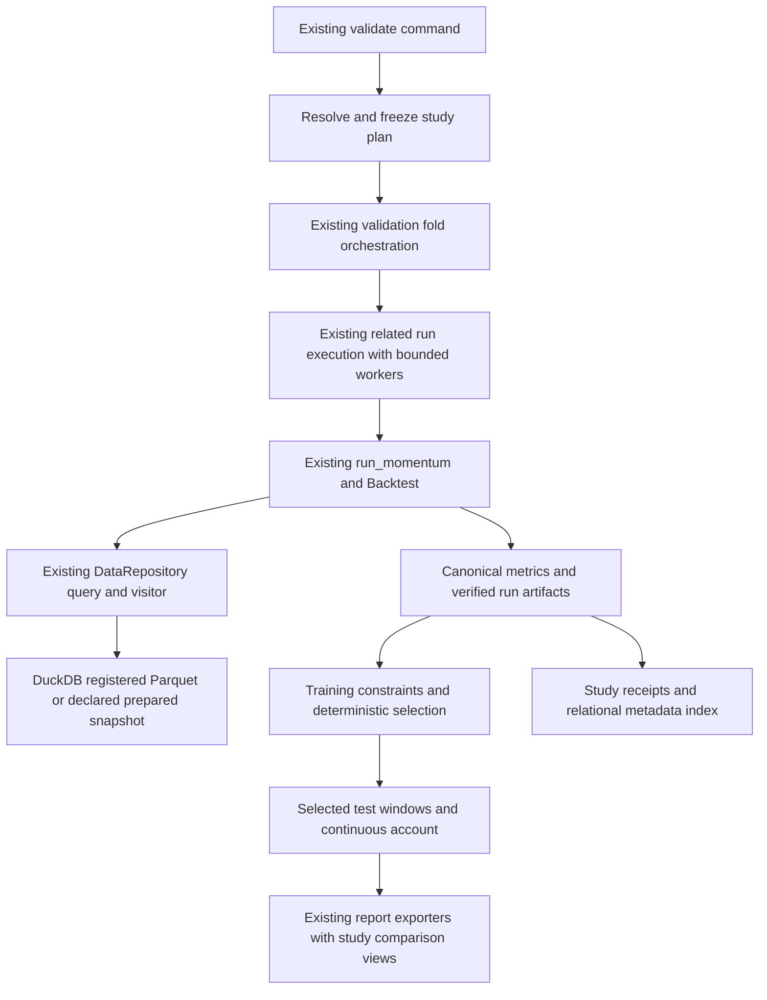

# Multi parameter studies implementation plan

Status: proposed enhancement to the existing framework. Prepared 23 November 2026. This plan adds study configuration, execution and analysis to AlgoFarmBT and its existing algoLibs interfaces. It does not introduce another strategy engine, ledger or market-data reader.

## First delivery

Implement the [basic grid search plan](basic-grid-search.md) first. That delivery expands grid declarations into the existing candidate/validation workflow and reuses sequential execution, accounting, visitors and result artifacts. Parallel workers, resume infrastructure, database indexing, allocation search and Bayesian optimization in this broader roadmap are later phases.

## Research direction

The research protocol in [Institutional evidence for parameter selection](parameter-selection-research.md) governs candidate design. Start with written economic/model hypotheses, few shared signal specifications, the existing horizon blend, explicit after-cost acceptance and training-only uncertainty. Keep risk sizing separate from signal calibration. Preserve several competitive settings or the baseline when differences are unsupported, and permit no deployable selection. A grid or Bayesian sampler is execution machinery rather than the research justification.

## Outcome and scope

A user defines parameter values, selection rules, chronology and resource limits in a study plan. The existing `validate` command previews the complete workload, freezes the study, executes ordinary backtests, records all outcomes and produces comparable results. Interrupted studies resume verified work. Every reported selection can be traced to its permitted training observations and reproduced from retained inputs.

Support two study modes with distinct selection contracts:

| Mode | Selection | Output |
|---|---|---|
| Fixed recipe | Rank candidates using declared development/training windows, freeze one recipe before final evaluation | One selected recipe and its subsequent evaluation |
| Walk forward selection | Rank candidates separately in each trailing training window, freeze each winner for the following test window | Selected recipe schedule and one continuous test account |

Development data may be partitioned chronologically for more stable fixed-recipe selection. If the search procedure itself is tuned, use inner training/validation splits and retain an outer evaluation interval. The existing walk-forward implementation provides the second mode; the first needs explicit chronology and training aggregation in the same validation runner. A full-history leaderboard may be shown as exploratory analysis, with its role clearly labelled.

The current BTC/ETH/SOL history has already been inspected. A new study on it remains development research. A new filename or final-year split does not make previously viewed results unseen; independent confirmation requires genuinely untouched observations or subsequent forward evaluation.

## Existing implementation to extend

| Existing module or interface | Current behavior | Planned change |
|---|---|---|
| `AlgoFarmBT/algoFarmBT/backtests/execute_momentum_backtest.py` | `validate`, preview, frozen-plan execution, portable replay; `run_momentum` calls the ordinary Backtest | Accept the new study schema and explicit resume/resource options; preserve the same entry point and execution calls |
| `backtests/validation.py` | Resolve candidates, generate folds, rank training results, run selected tests, compose continuous account | Resolve search spaces, apply training eligibility constraints, support both study modes, coordinate durable execution |
| `backtests/related_runs.py` | Serial ordered execution, case receipts, failures, canonical metric extraction | Add serializable trial descriptions, checkpoint/resume and bounded worker execution behind the existing related-run interface |
| `strategies/momentum_strategy.py` | Validated MomentumRecipe, configurable signal/risk inputs, fixed asset budgets/caps | Continue resolving every candidate through `load_recipe`; validate explicitly varied budget/cap sets |
| `_RecipeSchedule` in the momentum runner | Switch signal recipes while requiring fixed budgets/caps and account assumptions | Permit declared budget/cap changes over a fixed universe; retain one account and the existing timing rules |
| `algoLibs/algoLibs/dao/data_repository.py` | Routes data/query objects through domain-specific visitors | Use its existing market-data and relational routes for worker reads and study metadata |
| `algoLibs/algoLibs/backtest/report_frames.py` and `excel_report.py` | Validation, training, selection and account tables from retained reports | Add parameter comparisons, constraints, sensitivity views and study progress summaries |
| `backtests/research_history.py` and `algoLibs/backtest/validation_statistics.py` | Inspection eligibility and conditional uncertainty/multiple-trial evidence | Record this full-history exposure and the new trial history without inventing independent-trial counts |

Current code accepts at most **32 candidates**, **256 generated folds**, and **1,056 declared evaluations** for training selection. Execution is serial. Candidates and continuous recipe switches currently prohibit changing budgets, caps, allocation policy and rebalance policy. The validation path writes manifests and run artifacts to files; it does not currently register optimization studies or trial outcomes through `DataRepository.save`. Existing relational trade/order/holding models are not a study registry.

Some older paragraphs in the validation guide still describe earlier 32-fold limits. Update those descriptions with the implemented contract when delivering this enhancement; preserve v1/v2 behavior rather than interpreting old saved plans differently.

## Execution flow

Within a fold, all required candidate evaluations must finish before selection and test execution. Tests and the final continuous account follow the frozen chronology. The coordinator publishes selection receipts and aggregate reports; each worker owns one isolated trial directory. Market queries continue through `DataRepository.query` and `DataRequest.accept`, including when a declared portable study uses the existing SnapshotReader visitor.

## Enhancement 1 Study definition and candidate resolution

Introduce `chronological-validation-v3` alongside the existing v1/v2 schemas. Keep `validate --dry-run`, `--resolved-plan` and `--replay`. Add explicitly versioned resolved-study output instead of silently adding fields to the strict v2 validator.

The plan separates:

* **Research protocol:** source/universe, complete date bounds, hourly frequency, training/test windows, feature-history policy, selection mode/objective, eligibility constraints, inspection history and fallback rule.
* **Search parameters:** explicitly varied recipe fields or complete asset-budget/cap sets.
* **Fixed assumptions:** starting capital, brokerage costs, tick/lot rules, slippage, execution delay, auxiliary-data definitions, allocation semantics and the repaired-data gap policy.
* **Execution controls:** logical-evaluation budget, retry/attempt budget, maximum workers, disk/memory limits, output profile and seed.

Initially support explicit candidate lists, Cartesian grids and seeded sampling without replacement from a finite declared space. Use one candidate-resolution implementation shared by these representations, with every result passed through the existing recipe loader. Keep that helper internal to validation unless a second caller needs its interface. Do not add an abstract optimizer hierarchy for a single search method.

Reject unknown parameter names, invalid values, duplicate resolved recipes and incompatible combinations before account execution. Preserve decimal values exactly when hashing. Validate fast/slow horizon ordering, weight sums, cap/budget relationships, warmup requirements and the gap policy's supported return/variance estimator. Treat a declared full budget vector as one categorical choice; never vary its three entries independently into invalid sums.

Define the first candidate family from a documented hypothesis, such as whether slower collective horizon sensitivity can reduce turnover costs while retaining predictive content. Share its parameters across coins initially. Keep the volatility-sizing coefficient, budgets, execution assumptions and gap policy fixed while evaluating signals; risk/allocation studies are separate experiments. The prior 27-point volatility/smoothing/signal-span example is withdrawn as the recommended first experiment. Parameter bounds require justification before execution; see the linked research protocol.

Dry-run freezes candidate recipes/hashes, fold-specific observed history, maximum required warmup, source/code/auxiliary identities, metric definitions and constraints. It reports invalid combinations, expected executions and measured resource estimates. Resource estimates use representative existing trial runs and remain estimates.

As a capacity example only, at the current 217-fold schedule, 27 candidates require `217 × (27 training + 1 selected test) + 1 continuous account = 6,077` logical evaluations. Replace the hard-coded ceiling with a validated, explicit study budget and operational bounds. Keep all hourly history declared by the study; a budget overflow rejects the plan rather than truncating history, candidates or folds. Count any additional inner-validation/refit runs too. Retries consume a separately bounded physical-attempt budget.

## Enhancement 2 Durable trial records and metadata persistence

Define a small set of records around existing run artifacts:

| Record | Contents |
|---|---|
| Study | Frozen scientific definition, provenance, mode, declared budgets and execution status |
| Candidate | Fully resolved recipe, canonical hash and readable parameter values |
| Trial | Study/candidate/fold/phase, permitted data window, status, artifact reference and canonical metrics |
| Attempt | Physical execution identifier, logical trial identifier, timestamps, worker, error and retry lineage |
| Selection | Training cutoff, eligible candidates, scores, rule and chosen recipe |

Use a deterministic study-definition identity and trial identity. Keep physical attempt IDs separate. A trial identity includes source/code/auxiliary identities, complete resolved recipe, history/scoring dates, execution settings and metric/constraint versions. Worker count and completion order must not change scientific results. Run-configuration changes create a new definition, not a continuation of the old one.

Extend the existing case receipts into atomic checkpoints. Record queued, running, succeeded, failed, cancelled and interrupted attempts; retain ineligibility reasons separately from execution failures. A single coordinator owns scheduling/checkpoint updates and relational metadata publication. Publish each trial's existing sealed artifacts before marking it successful. Resume verifies the frozen definition, file inventory and hashes before reusing success; incomplete directories cannot become cached successes. A retry is a new attempt and never overwrites its predecessor.

The current exception handler deletes the entire staging directory. Add a v3 working-study lifecycle that retains completed trial artifacts after interruption and seals the final study only after completion. Preserve the existing destination-collision behavior for normal runs; only an explicit `--resume` may reopen a matching unfinished study. Completed sealed studies remain immutable.

For searchable PostgreSQL metadata, extend the **existing relational repository route**: study/trial data objects with `accept`, matching query objects, SQLAlchemy models and persistor/query visitor methods. Include the base visitor interfaces and a versioned schema migration. Default unsupported visitor methods should fail clearly without making unrelated legacy implementations abstract/uninstantiable. Do not add SQL connections or ORM queries inside optimization orchestration.

Store parameter definitions, exact numeric metrics, statuses and artifact locations in the index; retain full market data, fills, positions and workbooks in established artifacts. Use Decimal-compatible numeric fields or canonical decimal strings, not the legacy Float trade model as a new scientific ledger. Existing case receipts and manifests remain the durable result evidence; the SQL index is rebuilt from verified receipts. Upsert by deterministic receipt identity after artifact publication. If indexing fails, retain the successful trial and record pending indexing; resuming indexing must not repeat trading simulations. An explicitly required index must be complete before reporting full publication success.

## Enhancement 3 Bounded execution and efficient artifacts

Extend `run_related_cases` to execute serializable trial descriptions through the same ordinary child runner. Its present nested execution closures are unsuitable as process-pool tasks on macOS; make the task description serializable and construct the existing runner inside each worker. Keep sequential execution as the compatibility default.

Each worker opens its own declared repository/client and closes it when finished. Never share or pickle live DuckDB, SQLAlchemy or cursor objects. Native workers read the pinned registered Parquet through their own DuckDB visitor; an explicitly selected prepared-input mode uses the existing SnapshotReader repository. Backend provenance remains visible, and there is no silent reader fallback. Limit per-worker database threads and memory as well as the process count. Start with one or two workers on this machine, subject to preflight resource estimates.

Schedule independent training candidates concurrently. Retain chronological order in reports regardless of completion order, use the existing stable recipe-hash tie break, and leave the current candidate-failure rule authoritative. A missing/failed required candidate cannot disappear from ranking. Cancellation stops scheduling new work and preserves verified completed work and explicit receipts for interrupted work.

Add a versioned compact presentation profile for training trials to the existing exporter. Preserve canonical financial results, report metrics, daily observations, availability/data-access evidence and provenance. Allow omission of duplicate workbooks, unnecessary detailed traces and repeated source archives, using verified references to shared study inputs/code. Keep full reports for selected tests, the continuous account and requested detailed inspections. `case_metrics` must consume the same canonical metric definitions in both profiles, and full/compact profiles must produce identical selection scores and financial results. Existing full exports remain the default.

Freeze shared prices, native preparation, recipes and source once per study through existing snapshot interfaces. Any later computation cache must key on the full trial definition and causal history window; completed checkpoints are the first reuse mechanism. Do not add an unbounded in-memory price cache or a second data-access path.

## Enhancement 4 Selection and allocation contracts

Retain the supported canonical training objectives, net return and annualised daily Sharpe. Extend the research decision beyond the current highest-score rule: declare a baseline and incremental after-cost acceptance test, retain uncertainty/insufficient evidence, and optionally report a competitive candidate set. A model confidence set is one possible academic method requiring an explicit loss function and dependence-aware inference; it is not proof of positive edge or a universally disclosed fund procedure. Extend eligibility with declared limits such as maximum drawdown loss, turnover and minimum complete observations. Define units/signs explicitly: for example, a positive drawdown-loss limit is compared with the magnitude of the existing negative `max_drawdown`. Undefined metrics stay undefined and make affected constraints/objectives ineligible. Incomplete days remain excluded from daily risk calculations.

Specify one objective plus hard constraints before search; avoid an arbitrary blended score or changing the metric after seeing test outcomes. Retain a named, predeclared no-eligible-score fallback when requested, with a visible receipt; default absence of an eligible candidate prevents testing. An operational fallback does not turn rejected or insufficient evidence into a passed research result. A runtime failure continues to follow the declared failure policy.

For fixed-recipe mode, pin training aggregation across chronological development windows, choose once, then execute the declared evaluation with the frozen recipe. For walk-forward mode, preserve current per-fold selection. Search decisions may use only permitted training evaluations. A past test interval can later become training history under the frozen rolling schedule; future-fold outcomes cannot influence an earlier selection.

Permit asset budgets/caps to vary only when explicitly declared searchable. Update both `_candidate_recipes` and `_RecipeSchedule`, retaining a fixed instrument universe, quote currency, cost/execution assumptions and supported allocation policy. Validate sum of budgets at most one and per-asset cap at most its budget. The current prepared momentum path sizes targets from recipe budgets and calls `BacktestPortfolio.process_targets`; extend that actual caller contract. The legacy `NaiveAllocationStrategy.get_portfolio_allocation` path serves other callers and is not a substitute for this change.

At a selected recipe switch, new targets use the chosen budgets at the declared decision time. Existing Backtest/Portfolio/Trade/Holding logic performs changes, carries cash and cost basis, charges costs, and applies opening availability and delay rules. Retain the existing pending-intent timing semantics. An unavailable or unready asset leaves its assigned budget in cash without redistribution. Alternative allocation policies, new universes and rebalance-frequency models require separately specified extensions.

## Enhancement 5 Comparison reports and research validation

Extend `validation.json`, `validation_frames` and the existing workbook/chart exporters with:

* Study progress, logical trials versus physical attempts, resource use and failure counts.
* Candidate parameters, training scores, eligibility/constraint reasons, fees, turnover, drawdown, exposure and sample coverage.
* Selected parameters per fold and the continuous account's actual equity, positions and recipe switches.
* Parameter sensitivity tables and heatmaps, with the remaining dimensions fixed or their aggregation explicitly declared.
* Neighboring-parameter stability, time/asset attribution and comparison against the unchanged baseline.

Keep training leaderboards distinct from selected-test/continuous-account results. Do not fabricate a candidate's test score when only the fold winner was tested. A study that evaluates every candidate over the full sample must explicitly identify those comparisons as exploratory. Materialize report views from retained canonical metrics instead of recalculating another version of financial performance.

Record all attempted searches, including failures, retries, refinements and prior manual experiments when known. Trial count is not an effective independent-trial estimate. Preserve existing bootstrap/PSR/DSR eligibility and unavailable states, and extend the experiment history rather than presenting a guessed multiple-testing correction. Record the already inspected full BTC/ETH/SOL history in eligibility evidence. Changing training length or optimization frequency constitutes a new research protocol and must not use its own evaluation results as an unseen selection set.

## Delivery sequence and acceptance

Deliver the five enhancements in this order:

1. **Study definition:** v3 schema, explicit/grid/seeded candidate resolution, identity rules, dry-run workload/resource plan and backward compatibility.
2. **Durable records:** retained working studies, idempotent resume, attempt history and the relational metadata index/migration through repository visitors.
3. **Execution:** bounded workers, independent repository ownership, compact artifact profile and deterministic aggregation.
4. **Selection:** training constraints, fixed-recipe chronology and declared allocation changes across continuous switches.
5. **Analysis and integration:** comparison/sensitivity reports, complete research history and full-history end-to-end verification.

Acceptance is measured at the existing public interfaces: `validate` preview/execute/resume/replay, ordinary `run_momentum`/Backtest, and DataRepository data/query-object dispatch. Planned checks include:

* A finite grid has the expected unique valid recipes; invalid spaces and insufficient budgets fail before execution.
* One candidate reproduces the ordinary configured run; legacy v1/v2 fixtures retain their financial behavior.
* Serial and bounded-parallel execution choose identical recipes and match financial results; completion ordering has no effect.
* Interrupted studies resume only verified successes, retain failures, and reject changed code/data/configuration or tampered receipts.
* Training repository requests never pass their declared cutoff. Changing future prices cannot alter an earlier selection.
* Allocation-switch accounting, fees, cash and cost basis reconcile through existing ledger/audit interfaces; prelisting assets and residual gaps never produce artificial fills.
* Native and prepared replay callers use the intended repository visitor, and SQL metadata round trips use the relational route. Database indexing recovery never reruns completed accounts.
* Full and compact report profiles share identical canonical metrics and selection outcomes; unavailable sparse-data statistics stay unavailable.
* Final integration uses the complete repaired hourly dataset and all declared folds. Every trial has a retained outcome; selected continuous-account results receive the existing independent ledger audit and sealed replay checks.

No production search or database migration is part of preparing this plan. The first real study must freeze its parameter values, training protocol, objective/constraints and resource budget before execution. The earlier 27-candidate example remains only a capacity illustration; the first research study must follow the evidence-based protocol linked above.

## Later search methods

Add Bayesian/adaptive search only after the finite-search workflow is reliable. If adopted, an established library such as Optuna proposes parameters and consumes permitted training metrics; the existing runner still executes every backtest. Adaptive proposals cannot all be frozen during preview: pin the sampler/version/seed/budget and record proposals, observation order and decision receipts. Replay uses the recorded decisions. Asynchronous proposal order requires explicit reproducibility semantics. Distributed machines, aggressive early pruning and multi-objective frontiers are later extensions, not prerequisites for the initial study framework.
